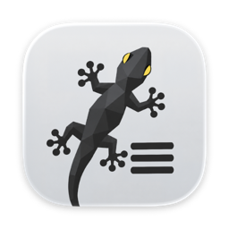
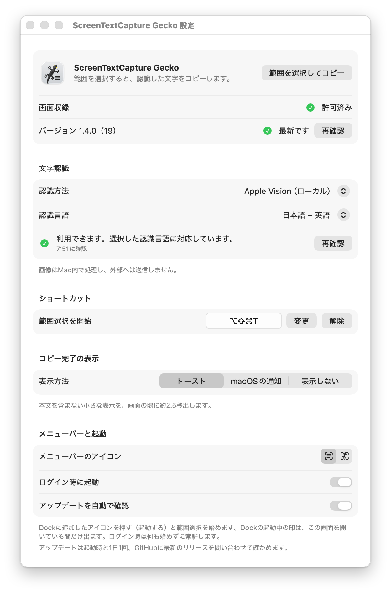

<p align="center">
  
</p>

<h1 align="center">ScreenTextCapture Gecko</h1>

<p align="center">画面の好きな範囲を選ぶだけで、写っている文字を読み取ってクリップボードにコピーする macOS アプリ<br>
<sub><a href="https://github.com/ku/screentextcapture">ku/screentextcapture</a> をもとに作り直したフォークです</sub></p>

<p align="center">
  <a href="https://github.com/743starlight/screen-text-capture-gecko/releases/latest"></a>
  
  <a href="LICENSE"></a>
</p>

> **English:** ScreenTextCapture Gecko is a macOS menu bar app that recognizes the text in any area of the screen you select and copies it to the clipboard. Recognition runs on-device with Apple Vision by default, and ChatGPT (Codex CLI) or Claude Code CLI can optionally be used with your own subscription. It is a fork of [ku/screentextcapture](https://github.com/ku/screentextcapture). The user interface is in Japanese.

## 特長

- **すぐ始められる** — Dock のアイコン、ショートカット（⌥⇧⌘T）、メニューバーのどこからでも範囲選択を始められます。
- **Mac の中で完結** — 既定の Apple Vision は、画像を Mac の外へ送りません。日本語・英語・中国語（簡体字・繁体字）・韓国語に対応しています。
- **生成 AI でも読める** — ChatGPT（Codex CLI）・Claude Code CLI を、ご自身の契約のログインで使えます。API キーは要りません。
- **控えめに知らせる** — コピーの完了は、トースト・macOS の通知・表示しない、から選べます。
- **常駐しても邪魔にならない** — メニューバーに常駐し、Dock に起動中の印を残しません。メニューバーのアイコンは、標準の記号とヤモリから選べます。
- **新しい版を知らせる** — GitHub のリリースを確かめて、新しい版があれば設定画面とメニューで知らせます。

<p align="center">
  
</p>

## 動作環境

- macOS 14 Sonoma 以降（Apple Silicon・Intel）
- 外部 CLI で読み取る場合: Codex CLI 0.142.5 以降、または Claude Code 2.1.112 以降

## インストール

1. [リリース](https://github.com/743starlight/screen-text-capture-gecko/releases/latest)から `ScreenTextCapture-Gecko-<版>.zip` をダウンロードして開き、`ScreenTextCapture Gecko.app` を「アプリケーション」フォルダへ移します。
2. アプリを開くと、すぐに範囲選択が始まります。初めて使うときは画面収録の許可が必要です。表示される説明の「macOSの設定を開く」から、システム設定の「プライバシーとセキュリティ」→「画面収録」で ScreenTextCapture Gecko を許可してください。許可した後に、アプリの再起動が必要な場合があります。
3. Dock から使うときは、アプリを Dock へドラッグして追加します。

配布しているアプリは、Developer ID で署名し、Apple の公証を受けています。

## 使い方

| したいこと | 操作 |
|---|---|
| 範囲選択を始める | Dock のアイコンを押す ／ ⌥⇧⌘T ／ メニューバーのアイコン →「範囲を選択してコピー」 |
| 範囲を選ぶ | ドラッグします。Esc で中止できます |
| 結果を受け取る | 読み取った文字がクリップボードに入り、トーストなどで知らせます |
| 設定を開く | メニューバーのアイコン →「設定…」 |

ログイン時に起動する設定にした場合は、何も始めずにメニューバーに常駐します。

## 設定

| 項目 | 内容 |
|---|---|
| 文字認識 | 認識方法（Apple Vision ／ ChatGPT（Codex CLI）／ Claude Code CLI）と認識言語。「利用可否を確認」で、選んだ方法が使えるかを確かめます |
| ショートカット | 範囲選択を始めるキーを変更・解除できます（⌘ または ⌃ を含む組み合わせ） |
| コピー完了の表示 | トースト（既定）・macOS の通知・表示しない。macOS の通知は、集中モード中や画面共有中にはバナーが出ないことがあります |
| メニューバーと起動 | メニューバーのアイコン（標準 ／ ヤモリ）、ログイン時に起動、アップデートを自動で確認 |

設定画面は、選んだ項目に合わせて高さが変わり、スクロールせずに見渡せます（macOS 15 以降。画面に収まらないときはスクロールします）。

## 外部 CLI（ChatGPT・Claude）で読み取る

Apple Vision の代わりに、ChatGPT（Codex CLI）や Claude Code CLI で読み取れます。読み取りにはご自身の契約のログインと利用枠を使い、アプリが API キーを保存することはありません。

1. CLI を入れて、端末でログインします（`codex login` または `claude auth login`）。デスクトップアプリへのログインだけでは、CLI は使えません。
2. 設定の「認識方法」で CLI を選び、CLI のパスを確かめます（Homebrew の既定は `/opt/homebrew/bin/codex`、`/opt/homebrew/bin/claude`）。
3. 「選択範囲の画像を〜へ送信」をオンにします。オンにするまで、画像は送りません。
4. 「利用可否を確認」で、ログインと使えるモデルを確かめます。モデルは CLI から取得した一覧から選べます（空欄は CLI の既定）。

**Fast モード**（既定はオフ）は、対応するモデルでだけ選べます。利用枠の消費が増えたり、追加の費用がかかったりすることがあります。Claude の Fast には Claude Code 2.1.205 以降と、対応する Opus・usage credits が必要です。

## プライバシーとセキュリティ

- 選んだ範囲の画像は、作業ごとに作る自分だけが読める一時フォルダに置き、成功・失敗・中止のどの場合も最後に消します。
- Apple Vision を使う場合、画像は Mac の外へ出ません。外部 CLI は、送信を許可したときだけ使います。
- CLI には API キーやトークンなどの環境変数を引き継がず、ツール・MCP・ファイルやコマンドの操作を無効にして呼び出します。アプリが CLI の資格情報を読み取ることはありません。
- 画像の中の文字は読み取る対象として扱い、指示として実行することはありません。
- アップデートの確認では、GitHub に最新のリリースを問い合わせます（アプリ名と版を送ります）。設定でオフにできます。
- コピーした文字や通知のプレビューは、macOS やクリップボード履歴のアプリに残ることがあります。

## ソースからビルドする

Xcode 26 以降が必要です（アプリのアイコンが Icon Composer 形式のため）。外部の Swift パッケージは使っていません。

```sh
make lint    # 構文と plist の確認
make test    # 単体テスト（外部の CLI やネットワークは使いません）
make build   # build/Build/Products/Release/ScreenTextCapture Gecko.app（自分の Mac で使う ad-hoc 署名）
```

配布用のビルド（Developer ID の署名・Apple の公証・staple・zip）は `scripts/build-release.sh` で作ります。公証の資格情報は、キーチェーンのプロファイル（`xcrun notarytool store-credentials`）か `scripts/notary.env` で渡します。使い方はスクリプトの先頭にあります。

Codex CLI で実際に読み取れるかは、`scripts/verify-codex.sh` で確かめられます（`--recognize` を付けると、合成した画像だけを送ります）。

## ライセンスと謝辞

[MIT License](LICENSE) です。

ScreenTextCapture Gecko は、[ku/screentextcapture](https://github.com/ku/screentextcapture)（Copyright © 2019 Kentaro "ku" KUMAGAI、MIT License）をもとに作り直したフォークです。Google Cloud Vision への依存を外し、Apple Vision・外部 CLI での読み取り、常駐、設定画面などを加えました。元の著作権表示は [LICENSE](LICENSE) に残しています。

アプリのアイコンと、メニューバーのヤモリの図柄は、このプロジェクトのために作ったものです。

ChatGPT・Codex は OpenAI、Claude は Anthropic、macOS・Apple Vision は Apple の商標です。このアプリは、これらの企業と提携しておらず、承認も受けていません。
